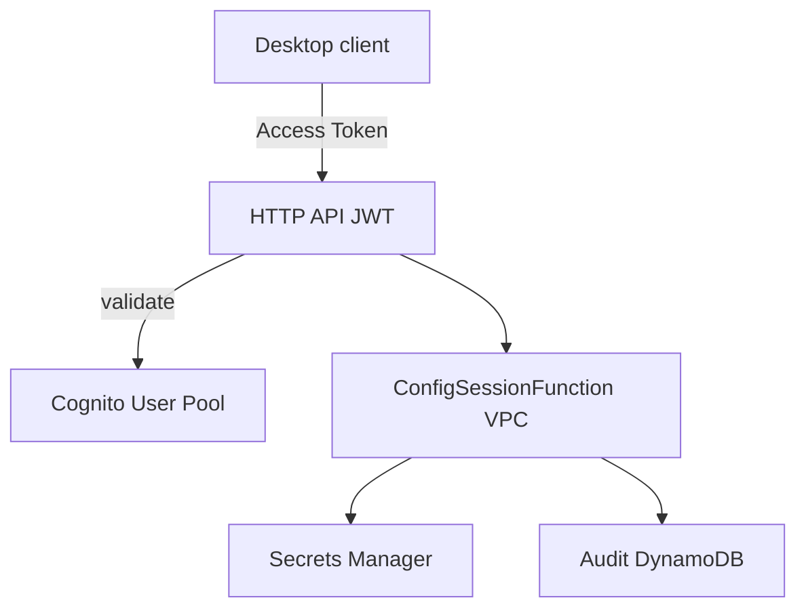

# Deployment Architecture — unit-auth-api-sam

## High-level

```text
Electron (later unit)
  | HTTPS + Cognito Access Token
  v
API Gateway HTTP API (JWT authorizer → Cognito User Pool)
  | AWS_PROXY
  v
Lambda ConfigSession (VPC: SG + subnets from SSM)
  |-- Secrets Manager  /dev/aidlc/auth-api/app-config
  +-- DynamoDB         ${Stack}-config-session-audit (TTL 90d)
```



## Deploy order

1. Confirm SSM paths exist in account for `dev` (SG + subnet-ids).
2. `cd auth-api && sam build && sam deploy --config-env devate` (profile `devate`).
3. Update Secret `/dev/aidlc/auth-api/app-config` with real `.env` JSON.
4. Create Cognito users (admin) with temp password; users set permanent password on first login (no TOTP).
5. Smoke: Postman `POST /config/session` with Access Token.
6. Hand outputs to `unit-cognito-auth-electron`.

## Networking notes

- Lambda runs in VPC using corporate default Lambda SG and subnet IDs from Parameter Store.
- Subnets must allow egress to Secrets Manager and DynamoDB (NAT Gateway and/or interface/gateway VPC endpoints). If deploy works but Lambda times out on AWS API calls, check endpoints/NAT first.

## Environments

| Env | Stack | Secret path | SSM prefix |
|---|---|---|---|
| dev (MVP) | `devate-aidlc-auth-api` | `/dev/aidlc/auth-api/app-config` | `/dev/ate/parameters/network/...` |
| qa/prod | Out of scope this delta | — | — |

## Text alternative (no Mermaid)

1. Client authenticates to Cognito (outside this diagram detail).  
2. Client calls HTTP API with Access Token.  
3. Authorizer validates token against User Pool.  
4. Lambda in VPC reads Secret, writes audit, returns `{ "config": ... }`.
