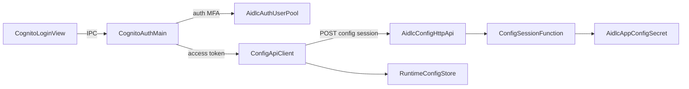

# Component Dependency — Cognito Auth + SAM API (delta)

## Dependency matrix

| Component | Depends on |
|---|---|
| CognitoLoginView | CognitoAuthMain (via IPC) |
| CognitoAuthMain | AidlcAuthUserPool (Cognito cloud) |
| ConfigApiClient | CognitoAuthMain (access token); AidlcConfigHttpApi |
| RuntimeConfigStore | ConfigApiClient |
| AppBootOrchestrator | CognitoAuthMain, ConfigApiClient, RuntimeConfigStore, ProfileSetup |
| GitLab / Bedrock clients | RuntimeConfigStore (replaces env/`aws-credentials.json`) |
| AidlcConfigHttpApi | AidlcAuthUserPool (JWT issuer); ConfigSessionFunction |
| ConfigSessionFunction | AidlcAppConfigSecret |
| AidlcAuthUserPool | — (root identity) |
| AidlcAppConfigSecret | — (root config data) |

## Communication patterns

| From → To | Pattern |
|---|---|
| Renderer → Main | IPC invoke (credentials, MFA code) |
| Main → Cognito | AWS Cognito API (HTTPS) |
| Main → HTTP API | HTTPS `POST /config/session` + Bearer Access Token |
| API Gateway → Lambda | JWT authorizer then proxy integration |
| Lambda → Secrets Manager | AWS SDK GetSecretValue |

## Data flow (text)

```text
[Renderer UI]
    | IPC username/password/MFA
    v
[CognitoAuthMain] ----HTTPS----> [Cognito User Pool]
    | access token (memory)
    v
[ConfigApiClient] ----HTTPS----> [HTTP API JWT] --> [Lambda] --> [Secrets Manager]
    | JSON config
    v
[RuntimeConfigStore] --> [GitLabService] [Bedrock/aws-config]
```


