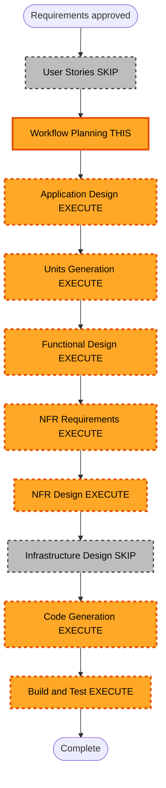

# Execution Plan (Delta) — Menu de modos + Chat Nova RAG / LanceDB

**Approved requirements**: 2026-08-03 (user: "continia")  
**Base document**: `aidlc-docs/inception/requirements/requirements.md` (FR-11..FR-14)

## Detailed Analysis Summary

### Transformation Scope
- **Project Type**: Brownfield (existing Electron + React app)
- **Transformation Type**: Feature add — dual workspace modes + RAG chat
- **Primary Changes**: Mode select UI; Chat panel; Bedrock Nova + Titan embeddings; LanceDB per projectId; pull→reindex; convert reply→observation; token stats
- **Related Components**: `RepoListPage`/`App` navigation, `WorkspacePage`, `ObservationsPanel`/`observations-service`, `load-config` (AWS env), existing `bedrock-client` remnants

### Change Impact Assessment
- **User-facing**: Yes — menu post-repo; chat mode; tokens; convert to observation
- **Structural**: Yes — new vector index layer + chat session in Main; mode routing
- **Data model**: LanceDB local tables/chunks; in-memory chat session; no Git schema change
- **API**: Bedrock Converse + InvokeModel embeddings; GitLab unchanged for content
- **NFR**: AWS secrets via `.env` only; token accounting; index refresh cost on pull

### Component Relationships
- **Primary**: unit-chat-rag-lancedb (new)
- **Touched**: shell/nav (mode menu), observations (pull reindex + append from chat), inception viewer (reuse tree/preview in both modes as needed)
- **Shared**: `shared/ai-config.ts`, path guards, user profile

### Risk Assessment
- **Risk Level**: Medium
- **Rollback**: Easy (desktop version rollback; LanceDB local can be deleted)
- **Unknowns**: LanceDB + Electron native deps packaging; Bedrock embedding latency/cost on full reindex

## Stage Decisions (this delta)

| Stage | Decision | Depth | Rationale |
|---|---|---|---|
| User Stories | **SKIP** | — | User chose Approve & Continue (not Add User Stories); FR acceptance criteria sufficient |
| Application Design | **EXECUTE** | Minimal | New chat/RAG components and mode routing |
| Units Generation | **EXECUTE** | Minimal | One primary unit: `unit-chat-rag-lancedb` (+ small nav touch) |
| Functional Design | **EXECUTE** | Standard | Chunking, retrieval, session, convert-to-observation |
| NFR Requirements | **EXECUTE** | Minimal | AWS env, token display, index refresh |
| NFR Design | **EXECUTE** | Minimal | Patterns for Bedrock + LanceDB |
| Infrastructure Design | **SKIP** | — | No cloud infra in-app; desktop only |
| Code Generation | **EXECUTE** | Standard | Full unit |
| Build and Test | **EXECUTE** | Minimal | Instructions + unit tests for pure logic |

## Workflow Visualization

### Text alternative
1. Requirements approved  
2. Skip User Stories (this delta)  
3. Workflow Planning (this document)  
4. Application Design (minimal)  
5. Units Generation (`unit-chat-rag-lancedb`)  
6. Functional Design → NFR Req → NFR Design  
7. Skip Infrastructure Design  
8. Code Generation → Build and Test  

## Unit focus (preview)

**unit-chat-rag-lancedb**
- Mode select screen after repo open
- Chat UI: messages, citations, convert-to-observation, token stats, session while app open
- Services: Nova chat, Titan embeddings, LanceDB index per `projectId`, reindex on observations pull
- Config: AWS from `.env` only

## Override note
You can change any SKIP/EXECUTE decision before we proceed.
