# Execution Plan (Delta) — Cognito Auth + SAM API + Secret `.env`

**Stories approved**: 2026-08-04 (user: "continua")  
**Requirements**: `requirements.md` FR-14, FR-17..FR-20  
**Stories**: US-01, US-02, US-13..US-16  
**Intent**: `cognito-auth-api-intent-analysis.md`

## Detailed Analysis Summary

### Transformation Scope (Brownfield)
- **Project Type**: Brownfield desktop (Electron + React) + **new** SAM backend folder
- **Transformation Type**: Architectural (auth gate + config delivery) + new infrastructure
- **Primary Changes**:
  1. Cognito User Pool + MFA; login UI en Electron antes de perfil
  2. SAM single-account: HTTP API + JWT authorizer + Lambda + Secrets Manager
  3. Config tipo `.env` solo en memoria Main; eliminar formulario/`aws-credentials.json`
- **Related Components**: `App.tsx` boot, ProfileSetup, aws-credentials-store (retire), aws-config, GitLab/Bedrock clients; nueva carpeta `auth-api/` (SAM)

### Change Impact Assessment
- **User-facing**: Yes — pantalla Cognito (+ MFA) al arrancar
- **Structural**: Yes — nuevo backend SAM; Main memory config store
- **Data model**: Secret JSON (claves `.env`); sin schema DB app
- **API**: Yes — nuevo HTTP API de configuracion
- **NFR**: Security (MFA, JWT, TLS, least privilege); no secretos en logs/disco

### Component Relationships
- **Primary Electron**: Login Cognito UI → Main IPC → memory config → consumers (GitLab, Bedrock)
- **Primary SAM**: Cognito User Pool → HTTP API JWT → Lambda → Secrets Manager
- **Sequence**: Disenar ambos → Units → construir **SAM primero** (deploy) → Electron contra API real / mocks en dev
- **Docs**: `documentation/Wiki.md`, `context.md`, `postman.json` (US-16 P1)

### Risk Assessment
- **Risk Level**: Medium–High (auth + secrets + nuevo stack)
- **Rollback**: Moderate (feature-flag / revert Electron boot; delete SAM stack)
- **Testing**: Moderate (Cognito MFA flows, JWT, Lambda secret, Electron memory lifecycle)

## Stage Decisions (this delta)

| Stage | Decision | Depth | Rationale |
|---|---|---|---|
| User Stories | **COMPLETED** | Standard | US-01..US-02, US-13..US-16 |
| Application Design | **EXECUTE** | Standard | Nuevos componentes Electron + contrato API + SAM resources |
| Units Generation | **EXECUTE** | Standard | Al menos 2 units (SAM + Electron); descomposicion clara |
| Functional Design | **EXECUTE** (per unit) | Standard | Contrato Secret JSON, flujos login/MFA, errores |
| NFR Requirements | **EXECUTE** (per unit) | Standard | Seguridad MFA/JWT/secrets; TLS |
| NFR Design | **EXECUTE** (per unit) | Standard | Patrones IAM, authorizer, no-log secrets, cache Lambda |
| Infrastructure Design | **EXECUTE** (unit SAM) | Standard | Cognito, HTTP API, Lambda, Secrets, samconfig `dev` |
| Infrastructure Design | **SKIP** (unit Electron) | — | Desktop; sin infra cloud propia |
| Code Generation | **EXECUTE** | Standard | SAM + Electron + docs |
| Build and Test | **EXECUTE** | Standard | Unit/integration + checklist MFA/API |

### Proposed units (preview — Units Generation will formalize)

| Unit | Scope | Deploy order |
|---|---|---|
| `unit-auth-api-sam` | Cognito User Pool+MFA, HTTP API, JWT authorizer, Lambda, Secrets Manager, samconfig, documentation/ | **First** |
| `unit-cognito-auth-electron` | Login UI+MFA, IPC, memory config, remove local AWS prompt/file, boot before profile | **Second** |

## Workflow Visualization

```mermaid
flowchart TD
  Start(["Stories approved"])
  WP["Workflow Planning THIS"]
  AD["Application Design EXECUTE"]
  UG["Units Generation EXECUTE"]
  U1["Unit auth-api-sam"]
  FD1["Functional Design EXECUTE"]
  NFRA1["NFR Requirements EXECUTE"]
  NFRD1["NFR Design EXECUTE"]
  ID1["Infrastructure Design EXECUTE"]
  CG1["Code Generation EXECUTE"]
  U2["Unit cognito-auth-electron"]
  FD2["Functional Design EXECUTE"]
  NFRA2["NFR Requirements EXECUTE"]
  NFRD2["NFR Design EXECUTE"]
  ID2["Infrastructure Design SKIP"]
  CG2["Code Generation EXECUTE"]
  BT["Build and Test EXECUTE"]
  EndNode(["Complete"])

  Start --> WP
  WP --> AD
  AD --> UG
  UG --> U1
  U1 --> FD1
  FD1 --> NFRA1
  NFRA1 --> NFRD1
  NFRD1 --> ID1
  ID1 --> CG1
  CG1 --> U2
  U2 --> FD2
  FD2 --> NFRA2
  NFRA2 --> NFRD2
  NFRD2 --> ID2
  ID2 --> CG2
  CG2 --> BT
  BT --> EndNode

  style WP fill:#FFA726,stroke:#E65100,stroke-width:3px,color:#000
  style AD fill:#FFA726,stroke:#E65100,stroke-width:3px,stroke-dasharray: 5 5,color:#000
  style UG fill:#FFA726,stroke:#E65100,stroke-width:3px,stroke-dasharray: 5 5,color:#000
  style FD1 fill:#FFA726,stroke:#E65100,stroke-width:3px,stroke-dasharray: 5 5,color:#000
  style NFRA1 fill:#FFA726,stroke:#E65100,stroke-width:3px,stroke-dasharray: 5 5,color:#000
  style NFRD1 fill:#FFA726,stroke:#E65100,stroke-width:3px,stroke-dasharray: 5 5,color:#000
  style ID1 fill:#FFA726,stroke:#E65100,stroke-width:3px,stroke-dasharray: 5 5,color:#000
  style CG1 fill:#FFA726,stroke:#E65100,stroke-width:3px,stroke-dasharray: 5 5,color:#000
  style FD2 fill:#FFA726,stroke:#E65100,stroke-width:3px,stroke-dasharray: 5 5,color:#000
  style NFRA2 fill:#FFA726,stroke:#E65100,stroke-width:3px,stroke-dasharray: 5 5,color:#000
  style NFRD2 fill:#FFA726,stroke:#E65100,stroke-width:3px,stroke-dasharray: 5 5,color:#000
  style ID2 fill:#BDBDBD,stroke:#424242,stroke-width:2px,stroke-dasharray: 5 5,color:#000
  style CG2 fill:#FFA726,stroke:#E65100,stroke-width:3px,stroke-dasharray: 5 5,color:#000
  style BT fill:#FFA726,stroke:#E65100,stroke-width:3px,color:#000
```

### Text alternative
1. Stories approved  
2. Workflow Planning (this document)  
3. Application Design (Electron + SAM contract)  
4. Units Generation (`unit-auth-api-sam`, `unit-cognito-auth-electron`)  
5. Per unit SAM: Functional Design → NFR Req → NFR Design → Infrastructure Design → Code Generation  
6. Per unit Electron: Functional Design → NFR Req → NFR Design → skip Infrastructure → Code Generation  
7. Build and Test  

## Package / module update sequence

1. **auth-api/** (SAM) — Cognito, Secret, Lambda, HTTP API, docs  
2. **Electron app** — Cognito SDK login, fetch config, memory store, retire local AWS credentials UX  
3. **Build and Test** — ambos + checklist manual MFA  

## Success Criteria
- Arranque exige Cognito+MFA antes de perfil  
- API JWT → Secret JSON en memoria; sin `aws-credentials.json`  
- Stack SAM `dev` / `us-east-1` documentado (Wiki/context/postman)  
- Extensions Security/Resiliency/PBT respetadas en design/code  

## Override note
Puedes cambiar cualquier decision SKIP/EXECUTE o el orden/numero de units antes de continuar.
