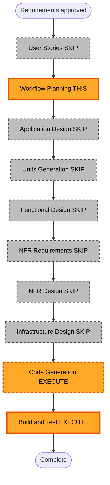

# Execution Plan (Delta) — Logs + Editar nombre de perfil

**Requirements approved**: 2026-08-03 (user: "continua")  
**Base document**: `aidlc-docs/inception/requirements/requirements.md` (FR-15, FR-16; FR-06 updated)

## Detailed Analysis Summary

### Transformation Scope
- **Project Type**: Brownfield (Electron + React)
- **Transformation Type**: Small feature add — file logging + profile edit
- **Primary Changes**: Logger en `logs/app.log` con truncado ~400 KB; clic en nombre topbar para editar perfil; archivo de observaciones nuevo si cambia el slug
- **Related Components**: `electron/main`, logger util, `App.tsx` topbar, `ProfileSetupPage` (reutilizar/adaptar), `user-profile-store`, `observations-service` (slug nuevo → archivo nuevo)

### Change Impact Assessment
- **User-facing**: Yes — editar nombre desde topbar
- **Structural**: No — util de logging + UI edit reusando store existente
- **Data model**: No schema change; mismo `user-profile.json`
- **API**: Sin cambios GitLab/Bedrock
- **NFR**: Observabilidad local (archivo); sin secretos en logs

### Component Relationships
- **Primary**: logger de Main + UI edit perfil
- **Touched**: `App.tsx`, `ProfileSetupPage` o variante edit, puntos de log en handlers/servicios clave
- **Shared**: `shared/user-profile.ts`, `user-profile-store`

### Risk Assessment
- **Risk Level**: Low
- **Rollback**: Easy
- **Testing**: Simple (truncate size, validate profile, slug file behavior)

## Stage Decisions (this delta)

| Stage | Decision | Depth | Rationale |
|---|---|---|---|
| User Stories | **SKIP** | — | Usuario eligio Approve & Continue; FR-15/16 + AC suficientes |
| Application Design | **SKIP** | — | Sin arquitectura nueva; logger util + reuso ProfileSetup / saveUserProfile |
| Units Generation | **SKIP** | — | Un cambio pequeno y directo; plan de Code Generation basta |
| Functional Design | **SKIP** | — | Reglas de negocio ya en FR-15/16 |
| NFR Requirements | **SKIP** | — | NFR-04 actualizado en requirements; sin NFR cloud nuevos |
| NFR Design | **SKIP** | — | Truncate + niveles info/warn/error definidos |
| Infrastructure Design | **SKIP** | — | Desktop; carpeta `logs/` local |
| Code Generation | **EXECUTE** | Minimal | Logger + UI edit + wiring |
| Build and Test | **EXECUTE** | Minimal | Tests unitarios de truncate/logger puro + checklist manual |

## Workflow Visualization

### Text alternative
1. Requirements approved  
2. Skip User Stories  
3. Workflow Planning (this document)  
4. Skip Application Design, Units, Functional Design, NFR Req/Design, Infrastructure  
5. Code Generation (logger + edit profile)  
6. Build and Test  

## Implementation focus (preview — Code Generation)

**FR-15 — Logs**
- `logs/` en raiz del workspace (`process.cwd()` / raiz del proyecto)
- `logs/app.log`; al superar ~400 KB truncar a vacio
- Niveles info / warn / error; init en Main; llamar desde handlers/servicios clave
- `.gitignore` ya ignora `*.log`; opcional `logs/.gitkeep` sin contenido

**FR-16 — Editar nombre**
- Clic en nombre del topbar → formulario (reusar validacion / `saveUserProfile`)
- Actualizar estado React del perfil al guardar
- Si cambia slug: no tocar archivo viejo; observaciones usan slug nuevo (archivo nuevo en el flujo habitual)

## Override note
Puedes cambiar cualquier decision SKIP/EXECUTE antes de continuar.
