# Execution Plan — ATE AI-DLC IDE

## Detailed Analysis Summary

### Transformation Scope
- **Project Type**: Greenfield
- **Transformation Type**: N/A (new desktop application)
- **Primary Changes**: Electron + React app integrating GitLab API and Gemini API
- **Related Components**: N/A (no existing packages)

### Change Impact Assessment
- **User-facing changes**: Yes — nueva app de escritorio para colaboradores funcionales
- **Structural changes**: Yes — arquitectura nueva (main/renderer, servicios GitLab/Gemini)
- **Data model changes**: Minimal — modelos de sesion, arbol de archivos, diffs, borradores de edicion (sin BD)
- **API changes**: Yes — cliente REST GitLab + cliente Gemini (consumidor, no servidor propio)
- **NFR impact**: Yes — seguridad de credenciales, TLS, logging, PBT, empaquetado Win/Linux

### Risk Assessment
- **Risk Level**: Medium
- **Rollback Complexity**: Easy (desktop; reinstalar version anterior del instalador)
- **Testing Complexity**: Moderate (API mocks + PBT en logica pura + pruebas de UI basicas)

## Workflow Visualization

```mermaid
flowchart TD
    Start(["User Request"])

    subgraph INCEPTION["INCEPTION PHASE"]
        WD["Workspace Detection<br/>COMPLETED"]
        RE["Reverse Engineering<br/>SKIP"]
        RA["Requirements Analysis<br/>COMPLETED"]
        US["User Stories<br/>COMPLETED"]
        WP["Workflow Planning<br/>IN PROGRESS"]
        AD["Application Design<br/>EXECUTE"]
        UG["Units Generation<br/>EXECUTE"]
    end

    subgraph CONSTRUCTION["CONSTRUCTION PHASE"]
        FD["Functional Design<br/>EXECUTE"]
        NFRA["NFR Requirements<br/>EXECUTE"]
        NFRD["NFR Design<br/>EXECUTE"]
        ID["Infrastructure Design<br/>SKIP"]
        CG["Code Generation<br/>EXECUTE"]
        BT["Build and Test<br/>EXECUTE"]
    end

    subgraph OPERATIONS["OPERATIONS PHASE"]
        OPS["Operations<br/>PLACEHOLDER"]
    end

    Start --> WD
    WD --> RE
    RE --> RA
    RA --> US
    US --> WP
    WP --> AD
    AD --> UG
    UG --> FD
    FD --> NFRA
    NFRA --> NFRD
    NFRD --> ID
    ID --> CG
    CG --> BT
    BT --> OPS
    BT --> EndNode(["Complete"])

    style WD fill:#4CAF50,stroke:#1B5E20,stroke-width:3px,color:#fff
    style RA fill:#4CAF50,stroke:#1B5E20,stroke-width:3px,color:#fff
    style US fill:#4CAF50,stroke:#1B5E20,stroke-width:3px,color:#fff
    style WP fill:#4CAF50,stroke:#1B5E20,stroke-width:3px,color:#fff
    style CG fill:#4CAF50,stroke:#1B5E20,stroke-width:3px,color:#fff
    style BT fill:#4CAF50,stroke:#1B5E20,stroke-width:3px,color:#fff
    style RE fill:#BDBDBD,stroke:#424242,stroke-width:2px,stroke-dasharray: 5 5,color:#000
    style ID fill:#BDBDBD,stroke:#424242,stroke-width:2px,stroke-dasharray: 5 5,color:#000
    style OPS fill:#BDBDBD,stroke:#424242,stroke-width:2px,stroke-dasharray: 5 5,color:#000
    style AD fill:#FFA726,stroke:#E65100,stroke-width:3px,stroke-dasharray: 5 5,color:#000
    style UG fill:#FFA726,stroke:#E65100,stroke-width:3px,stroke-dasharray: 5 5,color:#000
    style FD fill:#FFA726,stroke:#E65100,stroke-width:3px,stroke-dasharray: 5 5,color:#000
    style NFRA fill:#FFA726,stroke:#E65100,stroke-width:3px,stroke-dasharray: 5 5,color:#000
    style NFRD fill:#FFA726,stroke:#E65100,stroke-width:3px,stroke-dasharray: 5 5,color:#000
    style Start fill:#CE93D8,stroke:#6A1B9A,stroke-width:3px,color:#000
    style EndNode fill:#CE93D8,stroke:#6A1B9A,stroke-width:3px,color:#000
    style INCEPTION fill:#BBDEFB,stroke:#1565C0,stroke-width:3px,color:#000
    style CONSTRUCTION fill:#C8E6C9,stroke:#2E7D32,stroke-width:3px,color:#000
    style OPERATIONS fill:#FFF59D,stroke:#F57F17,stroke-width:3px,color:#000

    linkStyle default stroke:#333,stroke-width:2px
```



### Text Alternative
```
INCEPTION:
- Workspace Detection COMPLETED
- Reverse Engineering SKIP (greenfield)
- Requirements Analysis COMPLETED
- User Stories COMPLETED
- Workflow Planning IN PROGRESS
- Application Design EXECUTE
- Units Generation EXECUTE

CONSTRUCTION (per unit):
- Functional Design EXECUTE
- NFR Requirements EXECUTE
- NFR Design EXECUTE
- Infrastructure Design SKIP (no cloud infra; CI in code/build)
- Code Generation EXECUTE
- Build and Test EXECUTE

OPERATIONS: PLACEHOLDER
```

## Phases to Execute

### INCEPTION PHASE
- [x] Workspace Detection (COMPLETED)
- [x] Reverse Engineering (SKIPPED — greenfield)
- [x] Requirements Analysis (COMPLETED)
- [x] User Stories (COMPLETED)
- [x] Workflow Planning (IN PROGRESS)
- [ ] Application Design — EXECUTE
  - **Rationale**: App nueva con componentes Electron main/renderer, servicios GitLab y Gemini, reglas de rama `dev` e inception
- [ ] Units Generation — EXECUTE
  - **Rationale**: Descomponer en unidades (shell+auth, viewer P0, gemini+MR P1, packaging) para construccion ordenada

### CONSTRUCTION PHASE
- [ ] Functional Design — EXECUTE (por unidad)
  - **Rationale**: Logica de arbol, diffs, ediciones en sesion, commit/MR
- [ ] NFR Requirements — EXECUTE (por unidad)
  - **Rationale**: Security/Resiliency/PBT activos; credenciales, TLS, logging
- [ ] NFR Design — EXECUTE (por unidad)
  - **Rationale**: Incorporar patrones NFR tras assessment
- [ ] Infrastructure Design — SKIP
  - **Rationale**: Sin recursos cloud; empaquetado/CI se cubren en Code Generation y Build and Test
- [ ] Code Generation — EXECUTE (ALWAYS)
- [ ] Build and Test — EXECUTE (ALWAYS)

### OPERATIONS PHASE
- [ ] Operations — PLACEHOLDER

## Proposed Units (preview — formalizado en Units Generation)
1. **unit-shell-auth-repos** — Electron shell, login sesion, listado repos, rama `dev`
2. **unit-inception-viewer** — Arbol inception, preview MD, cambios recientes (P0)
3. **unit-gemini-publish** — Chat Gemini, ediciones en sesion, commit/MR a `dev` (P1)
4. **unit-packaging** — electron-builder NSIS/AppImage/deb + pipeline CI propuesto

## Estimated Timeline
- **Total stages to execute (remaining)**: Application Design, Units Generation, then per-unit FD/NFR/NFRD/CG, Build and Test
- **Estimated duration**: Multi-session (complex greenfield desktop app)

## Success Criteria
- **Primary Goal**: App Electron+React usable por colaboradores funcionales sobre rama `dev` y `aidlc-docs/inception/`
- **Key Deliverables**: Codigo app, instaladores Win/Linux, tests, documentacion aidlc
- **Quality Gates**: Requisitos FR-01..FR-10; historias P0; security (no persistir passwords); PBT en logica pura

## Extension Compliance (Workflow Planning)
| Extension | Status | Notes |
|---|---|---|
| Security | Compliant (planned) | Stages NFR include security design |
| Resiliency | Compliant / N/A | Desktop DR N/A; CI propose in packaging unit |
| PBT | Compliant (planned) | Functional Design + Code Gen per unit |
